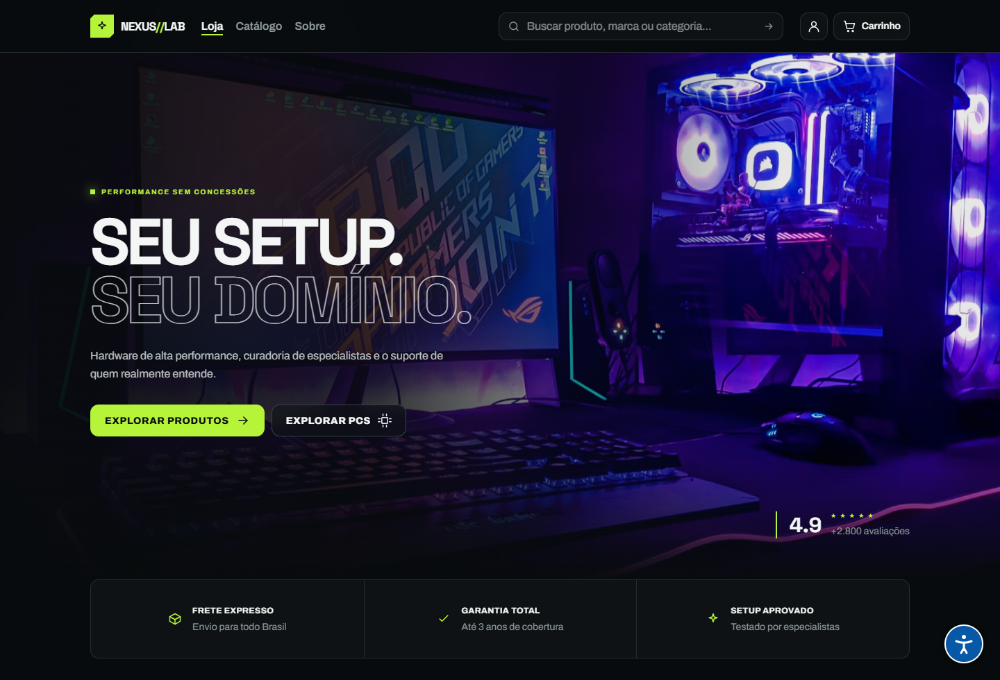

<h1 align="center">NEXUS//LAB · Geek Peripherals Store</h1>

<p align="center"><strong>Seu setup. Seu domínio.</strong><br/>Loja virtual de periféricos e componentes para computadores.</p>

<p align="center">React · TypeScript · Vite · Node.js · Express · MongoDB Atlas</p>

<p align="center">
  <a href="#status">Status</a> ·
  <a href="#estrutura">Estrutura</a> ·
  <a href="#execução-local">Como executar</a> ·
  <a href="docs/requisitos.md">Requisitos</a> ·
  <a href="docs/contrato-api.md">Contrato da API</a>
</p>

---

## Sobre o projeto

Projeto acadêmico de Arquitetura Web: um e-commerce geek especializado em periféricos de computadores, com loja virtual e painel administrativo.

## Status

O repositório contém o frontend React e uma API Express/MongoDB com autenticação, produtos, pedidos e painel administrativo. O frontend tem modo local de demonstração e modo API. O checkout visual existe, mas a API ainda não persiste o endereço nem integra pagamentos; Pix, cartão e boleto permanecem simulados, sem cobrança ou envio de dados de cartão.

## Design

[E-commerce Gamer e Dashboard — Figma Make](https://www.figma.com/make/Hgswb9fAi6Bah2m0mEPPNF/E-commerce-Gamer-e-Dashboard)

## Tecnologias exigidas

- Frontend: React, react-router-dom, fetch ou axios, layout responsivo.
- Backend: Node.js, Express, MongoDB e Mongoose, organizado em MVC para API JSON.
- Segurança: login, senhas com hash bcrypt, perfis de administrador e usuário, autorização e validação no servidor.

## Estrutura

```text
client/                 # Frontend React + camada de serviços HTTP
server/                 # Backend API MVC
docs/
  requisitos.md         # Checklist da entrega
  contrato-api.md       # Proposta para integração entre a dupla
  github.md             # Criação do repositório e uso de Git
```

## Funcionalidades planejadas

- Catálogo, busca e filtro por categoria.
- Detalhes e galeria de imagens dos produtos.
- Cadastro, login, logout e estado do usuário autenticado.
- Carrinho e criação de pedidos.
- Área administrativa para gerenciar produtos e visualizar vendas.
- Rotas de interface restritas conforme o perfil, com autorização efetiva também na API.
- Indicadores de carregamento, mensagens de erro e adaptação a desktop e celular.

## Execução local

```bash
# Terminal 1 — backend
cd server
npm install
Copy-Item .env.example .env
# Configure MONGODB_URI e troque JWT_SECRET por um segredo aleatório com pelo menos 32 caracteres.
npm run dev

# Terminal 2 — frontend
cd client
npm install
# Copie .env.example para .env; VITE_API_URL aponta para a API.
npm run dev
```

O frontend usa dados locais quando `VITE_DEMO_MODE=true`; defina `VITE_DEMO_MODE=false` para chamar a API (padrão `http://localhost:3000/api`). Consulte [docs/contrato-api.md](docs/contrato-api.md) para as rotas e os limites atuais da integração. Nunca publique arquivos `.env` ou credenciais reais.

## Entrega acadêmica

O projeto completo precisa demonstrar cadastro, login, erro de login, CRUD de pelo menos duas entidades relacionadas e diferença de acesso entre administrador e usuário. A apresentação deve durar de 3 a 5 minutos.

Veja o [checklist de requisitos](docs/requisitos.md). O frontend isolado não conclui os requisitos de backend, persistência ou segurança do trabalho.

## Equipe

Preencher antes da entrega:

| Integrante | Responsabilidade |
| --- | --- |
| Yan Teixeira | Frontend |
| Lucas Gabriel | Backend |

## Colaboração

Use branches por funcionalidade e commits semânticos, por exemplo: `feat: adiciona catálogo de produtos`, `fix: corrige validação de login` e `docs: atualiza instruções de execução`.
